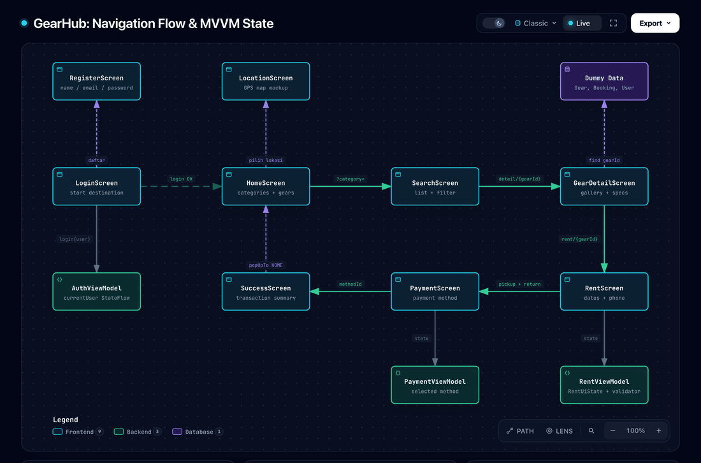

GearHub
GearHub adalah aplikasi peer-to-peer (P2P) untuk menyewa dan menyewakan perlengkapan kamera, lensa, audio, dan lighting bagi mahasiswa, freelancer, dan content creator yang membutuhkan peralatan tanpa harus membelinya. Aplikasi ini memiliki fitur login dan daftar, beranda, pencarian dan filter gear, pemilihan lokasi, detail gear, pengajuan sewa, pembayaran, serta ringkasan transaksi.



*Diagram alur navigasi GearHub (dibuat dengan [Archify](https://github.com/tt-a1i/archify)). Garis hijau adalah alur utama penyewaan beserta argumen yang dikirim antar layar, garis putus-putus adalah cabang atau kembali ke layar sebelumnya, dan kotak hijau adalah ViewModel yang memegang state. Versi interaktif: [docs/gearhub-flow.html](docs/gearhub-flow.html), buka di browser.*

## Alur Utama Aplikasi
Login → Beranda → Pencarian (filter kategori) → Detail Gear → Ajukan Sewa → Pembayaran → Sukses → kembali ke Beranda.

Akun demo untuk login:
- Email: `jane.doe@student.umn.ac.id`
- Password: `password123`

## Pemenuhan Ketentuan UTS
| Ketentuan | Implementasi di GearHub | Lokasi kode |
|---|---|---|
| Minimal 5 layar | 9 layar: Login, Daftar, Beranda, Pilih Lokasi, Pencarian, Detail Gear, Ajukan Sewa, Pembayaran, Sukses | `ui/screens/` |
| Layar List | Pencarian: daftar gear dengan pencarian teks dan filter kategori | `ui/screens/search/SearchScreen.kt` |
| Layar Detail | Detail Gear: galeri foto, spesifikasi, isi paket, kalender ketersediaan | `ui/screens/detail/GearDetailScreen.kt` |
| Layar Form/Input | Ajukan Sewa (tanggal pickup/return dan nomor telepon), serta Login dan Daftar | `ui/screens/rent/`, `ui/screens/auth/` |
| Layar UI fitur native (mockup) | Pilih Lokasi: tampilan peta/GPS berupa mockup, tanpa akses GPS sungguhan | `ui/screens/location/LocationScreen.kt` |
| Layar bebas | Pembayaran dan halaman Sukses dengan ringkasan transaksi | `ui/screens/payment/` |
| Custom Material 3 theme | Color scheme sendiri (biru `#005596` dan kuning `#F5C542`), font Rethink Sans untuk seluruh skala tipografi, shape system custom | `ui/theme/Color.kt`, `Type.kt`, `Shape.kt`, `Theme.kt` |
| State management | `remember`/`rememberSaveable` + `mutableStateOf` untuk input, filter, dan loading; `AuthViewModel`, `RentViewModel` (`RentUiState`), dan `PaymentViewModel` untuk state antar layar | `ui/screens/*` |
| Navigation + argumen | `NavHost`/`NavController` di `AppNavGraph.kt`. Argumen: `gearId` (List → Detail → Sewa), `category` (Beranda → Pencarian), `pickup`/`returnDate` (Sewa → Pembayaran), `methodId` (Pembayaran → Sukses) | `navigation/AppNavGraph.kt`, `navigation/Routes.kt` |
| Validasi input | Email: `KeyboardType.Email` + format email kampus `.ac.id`. Nomor telepon: `KeyboardType.Number`, hanya angka, diawali `08`, 10–13 digit. Password minimal 8 karakter. Semua field wajib tidak bisa disubmit kosong dan pesan error tampil langsung di bawah field | `util/AuthValidator.kt`, `util/RentValidator.kt` |
| Dummy data | Data class `Gear`, `Booking`, `User`, `PaymentMethod`. Berisi 10 gear nyata dengan foto, 12 data booking untuk kalender ketersediaan, 3 metode pembayaran, dan 2 akun pengguna | `data/model/`, `data/dummy/` |

## Struktur Project
```
app/src/main/java/org/umn/gearhub/
├── data/
│   ├── model/        # data class: Gear, Booking, User, PaymentMethod, GearCategory
│   └── dummy/        # dummy data gear, booking, user, pembayaran, lokasi
├── navigation/       # AppNavGraph (NavHost) dan Routes
├── ui/
│   ├── theme/        # Color, Type, Shape, Theme (Material 3)
│   ├── components/   # GearCard, BottomNavBar, AuthTextField, AvailabilityCalendarDialog
│   └── screens/      # auth, home, location, search, detail, rent, payment
└── util/             # validator, kalkulasi harga, format tanggal dan Rupiah
```

## Cara Menjalankan
1. Buka folder project di Android Studio.
2. Tunggu Gradle sync selesai.
3. Jalankan konfigurasi `app` di emulator atau perangkat Android (minimal Android 8.1, API 27).
4. Untuk membuat APK: `./gradlew assembleDebug`. Hasilnya ada di `app/build/outputs/apk/debug/app-debug.apk`.

Fitur yang Dikembangkan
- Autentikasi: Login dan registrasi
- Beranda: Menampilkan perlengkapan gear yang tersedia dan informasi lokasi
- Pencarian: Mencari gear dan memfilter berdasarkan kategori
- Detail Gear: Menampilkan informasi gear
- Ajukan Sewa: Memilih tanggal sewa dan melihat ringkasan biaya
- Pembayaran: Memilih metode pembayaran dan melihat ringkasan transaksi
- UI fitur native: Pilih Lokasi untuk menampilkan dan memilih lokasi gear terdekat (di Beranda dan Pencarian)

Nama kelompok: kebetulan berempat
Nama anggota:
1. Amanda Aliyah (00000135964)
2. Aisha Reissani Sopyan (00000136172)
3. Kenny Valent Winalda Sembiring (00000136177)
4. Vaurolla Az Zahra (00000139045)

Pembagian tugas
1. Amanda Aliyah (00000135964)
- Membuat struktur navigasi aplikasi (NavHost, NavController, dan Routes)
- Mengimplementasikan halaman Login dan Daftar
- Membuat komponen form autentikasi
- Membuat validasi nama, email kampus, dan password
- Mengelola state pengguna melalui AuthViewModel
- Menyiapkan dummy data pengguna

2. Aisha Reissani Sopyan (00000136172)
- Membuat tema aplikasi menggunakan Material 3, meliputi warna, typography, dan shapes
- Mengimplementasikan halaman Beranda
- Membuat komponen GearCard dan BottomNavBar
- Membuat halaman Pilih Lokasi beserta state lokasi terpilih
- Mengelola kategori gear dan helper inisial nama

3. Kenny Valent Winalda Sembiring (00000136177)
- Membuat model dan dummy data gear beserta data booking
- Mengimplementasikan halaman Pencarian dan filter kategori
- Membuat halaman Detail Gear dengan informasi, galeri foto, dan spesifikasi
- Membuat dialog kalender ketersediaan gear
- Mengelola logika ketersediaan tanggal serta helper format tanggal dan Rupiah

4. Vaurolla Az Zahra (00000139045)
- Mengimplementasikan halaman Ajukan Sewa dengan pemilihan tanggal dan input nomor telepon
- Membuat RentViewModel, RentUiState, dan validasi sewa
- Menghitung durasi sewa, biaya layanan, deposit, dan total pembayaran
- Membuat halaman Pembayaran beserta pilihan metode pembayaran
- Mengimplementasikan halaman Sukses dengan ringkasan transaksi
- Menyiapkan dummy data metode pembayaran dan utilitas tanggal

Sistem Kerja Kelompok
Kelompok membagi tugas berdasarkan fitur dan tanggung jawab masing-masing anggota dengan mengikuti alur pengembangan aplikasi GearHub, mulai dari fondasi aplikasi dan autentikasi, tampilan beranda, pencarian dan detail gear, hingga proses penyewaan dan pembayaran. Setiap anggota bertanggung jawab atas implementasi fitur yang telah dibagi. Integrasi dilakukan dengan menyelaraskan struktur navigasi, model data, dan komponen UI agar seluruh fitur dapat berjalan sebagai satu aplikasi. Kelompok juga melakukan koordinasi dan pengecekan bersama untuk memastikan fitur terintegrasi dengan baik.
